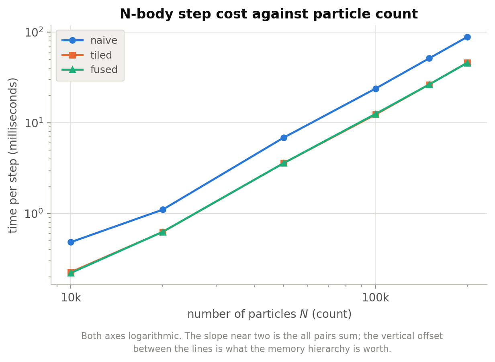
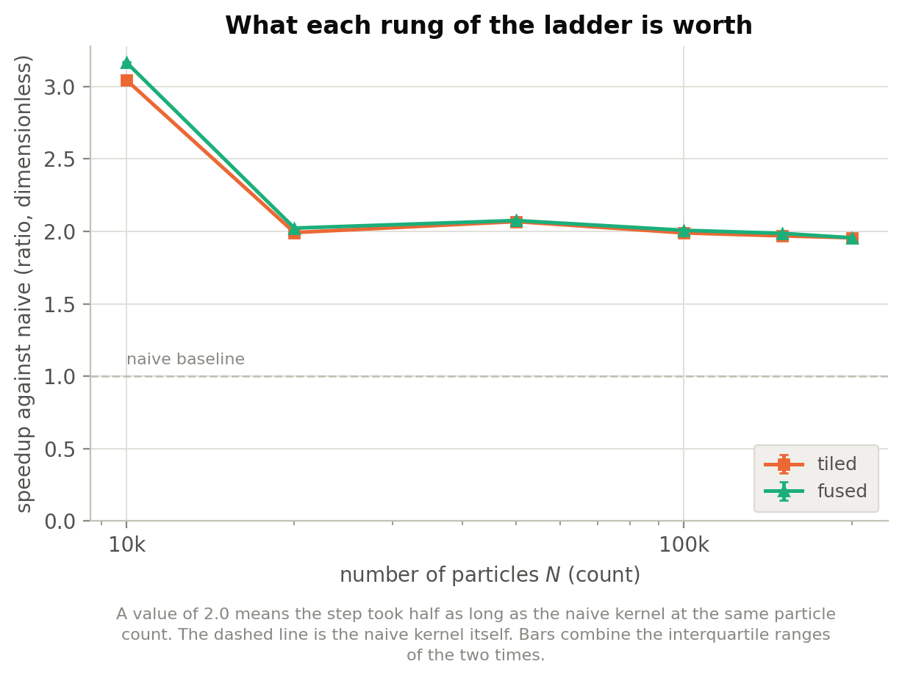
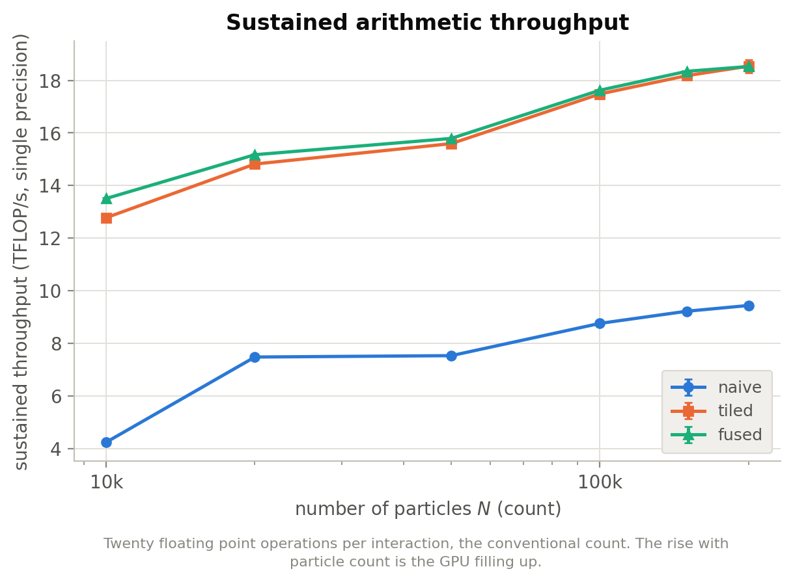
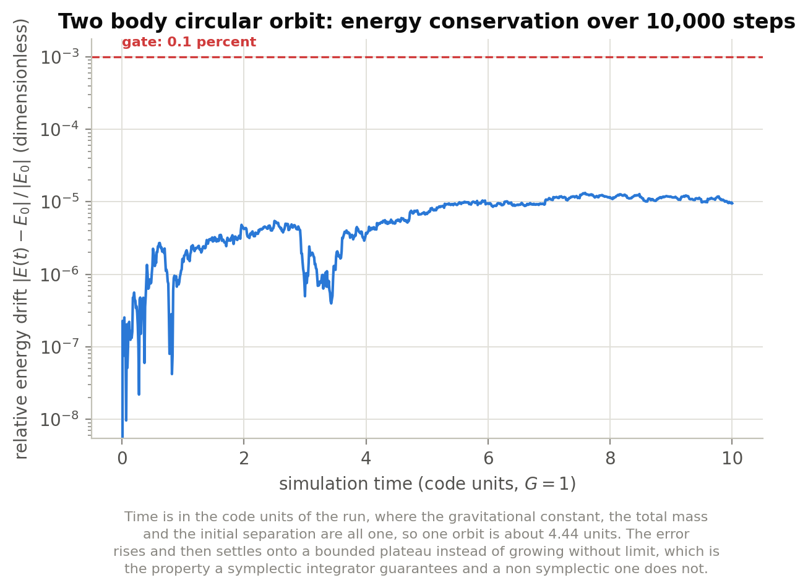
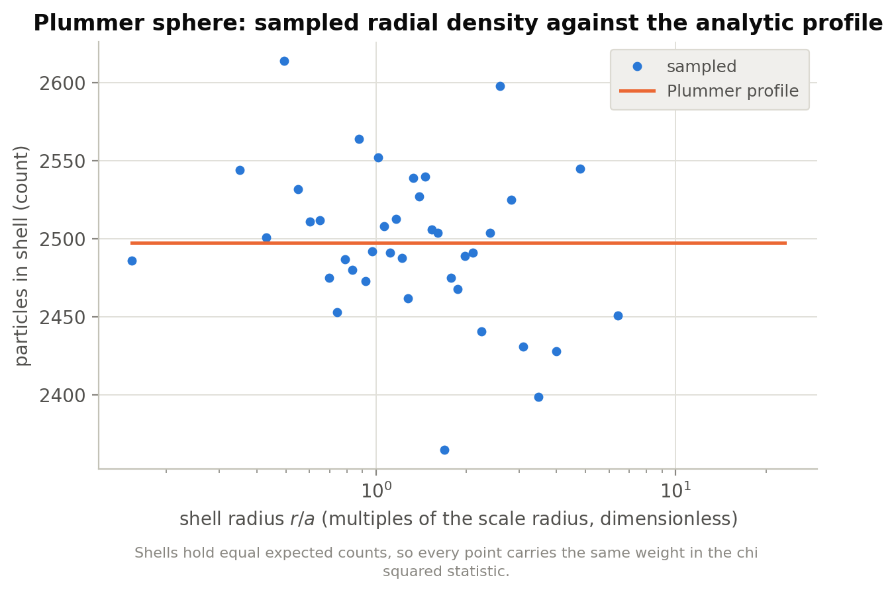
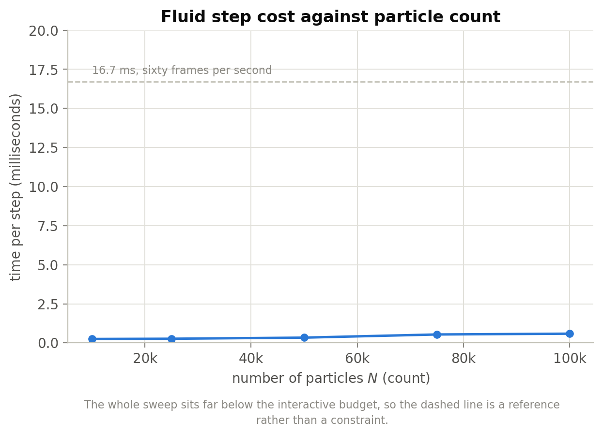
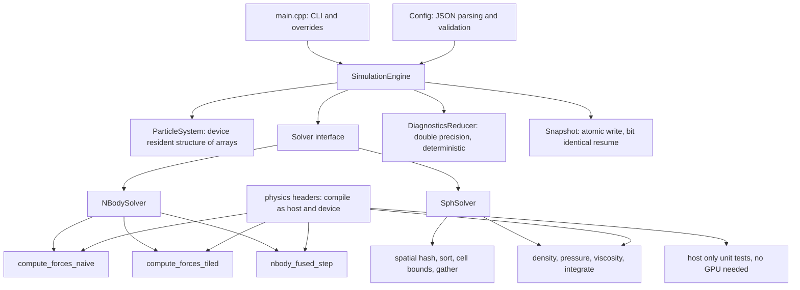

# Particle Physics Simulation

**A CUDA particle physics engine where every optimisation is a measured result and every physical law is enforced by a test.**

[](https://github.com/Olajide-Badejo/Particle-Physics-Simulation/actions/workflows/ci.yml)
[](LICENSE)
[](https://developer.nvidia.com/cuda-toolkit)
[](https://en.cppreference.com/w/cpp/23)
[-333.svg)](#reference-machine)

Two solvers sitting at opposite ends of the spectrum a GPU cares about:
**direct all pairs gravitational N-body dynamics**, which is regular and
arithmetic bound, and **weakly compressible smoothed particle hydrodynamics**
with spatial hash neighbour search, which is irregular and has to rediscover
its own data dependencies every step.

Author: **Olajide Badejo**

---

## Contents

- [What this project is](#what-this-project-is)
- [Headline results](#headline-results)
- [The kernel ladder](#the-kernel-ladder)
- [Two results that contradicted my expectations](#two-results-that-contradicted-my-expectations)
- [Physics correctness](#physics-correctness)
- [The fluid solver](#the-fluid-solver)
- [Architecture](#architecture)
- [Reports and documents](#reports-and-documents)
- [Build and run](#build-and-run)
- [Reference machine](#reference-machine)
- [Repository layout](#repository-layout)

---

## What this project is

Most GPU projects claim a speedup. This one is built to make the claim
falsifiable, and it is organised around two commitments.

**No number without a run.** Every performance figure in this repository was
produced by a program here, written to a CSV alongside the commit, GPU, driver
and seed that produced it, and read back into the documents mechanically. In
this file each measured value carries a hidden mark naming its metric, and
`scripts/check_doc_numbers.py` fails when a mark disagrees with the recorded
results. Continuous integration runs that check, and fails if a generated table
stops matching its source data. The only typed values are `v1.0.0` values in
correction records, labelled as such, and a few correction figures from one off
runs that no CSV records, which the Reproducibility section names.

**Correctness is enforced, not observed.** A particle simulation that is subtly
wrong still looks convincing: fluid still sloshes, stars still orbit. So
correctness is pinned by <!-- num:GateCount -->14<!-- /num --> conservation and distribution gates with hard
numerical thresholds, run by the test suite on a machine with a GPU, against a
library compiled with fast math disabled so that no compiler flag can quietly
relax them. Continuous integration has no GPU: it runs the host entries, and the
device entries show as Skipped rather than passed.

Both commitments earned their keep by telling me I was wrong, which is
what the [two corrections](#two-results-that-contradicted-my-expectations)
below are about. They also failed once, and `v1.0.0` published claims that were
wrong; [CHANGELOG.md](CHANGELOG.md) lists each one under Corrections to v1.0.0.

---

## Headline results

| | |
|---|---|
| **Shared memory tiling** | **<!-- num:TilingSpeedupAtMaxN -->1.96<!-- /num -->x faster** than the naive kernel at <!-- num:LadderMaxN -->200,000<!-- /num --> particles (paired ratio <!-- num:TiledOverNaiveRatioAtMaxN -->0.5110<!-- /num -->, IQR <!-- num:TiledOverNaiveRatioIqrAtMaxN -->0.0103<!-- /num -->) |
| **Sustained throughput** | **<!-- num:TiledGigaInteractionsAtMaxN -->927<!-- /num --> billion interactions per second**, which is <!-- num:TiledTflopsAtMaxN -->18.54<!-- /num --> TFLOP/s at the conventional <!-- num:ConventionalFlopsPerInteraction -->20<!-- /num --> flops per interaction and <!-- num:TiledTflopsAtMeasuredFlops -->16.72<!-- /num --> at the <!-- num:MeasuredFlopsPerInteraction -->18.0<!-- /num --> the counters report |
| **Fluid solver** | **50,000 particles at <!-- num:SphMsAtFiftyThousand -->0.345<!-- /num --> ms/step**, about <!-- num:SphInteractiveMargin -->48<!-- /num -->x inside a 60 frame per second budget |
| **Physics gates** | **<!-- num:GateCount -->14<!-- /num --> of <!-- num:GateCount -->14<!-- /num --> pass**; [the validation document](docs/physics_validation.md) says what each one is evidence of |
| **Two body energy error** | **<!-- num:EnergyDriftMeasured -->1.33e-5<!-- /num -->** over 10,000 steps against a 1e-03 limit. This is single precision rounding, so the integrator's order is gated separately in double precision |
| **Snapshot and resume** | **bit identical**, proven for all four solver paths |

Measured at commit `<!-- num:BenchCommit -->a27a69ed5ec4<!-- /num -->` with session drift of <!-- num:RepeatabilitySpread -->0.17<!-- /num --> percent.

---

## The kernel ladder

Three N-body force kernels differ by exactly **one technique each**, so the
difference between two rungs is attributable to that technique. A parity test
asserts all three agree with an independent double precision CPU reference, so a
performance difference can never be a difference in what is being computed. The
fused rung's technique also brings the leapfrog form of the integrator with it.

Each configuration is measured for ten trials, interleaved round by round with the
others it is compared with, so that session drift cancels. Times are medians at the
default tile width of <!-- num:BestTileWidth -->256<!-- /num -->. The fused against tiled column is the median
and interquartile range of the time ratio inside each round; below 1 favours fused.
Interactions per second is the throughput; multiply by the flops convention above for
TFLOP/s.

| particles | naive (ms) | tiled (ms) | fused (ms) | tiled speedup | fused / tiled (IQR) | tiled interactions/s (billions) |
|---:|---:|---:|---:|---:|---:|---:|
| 10,000 | <!-- num:NaiveMsAtTenThousand -->0.471<!-- /num --> | <!-- num:TiledMsAtTenThousand -->0.156<!-- /num --> | <!-- num:FusedMsAtTenThousand -->0.148<!-- /num --> | <!-- num:TilingSpeedupAtTenThousand -->3.01<!-- /num -->x | <!-- num:FusedOverTiledRatioAtTenThousand -->0.9445<!-- /num --> (<!-- num:FusedOverTiledIqrAtTenThousand -->0.0075<!-- /num -->) | <!-- num:TiledGigaInteractionsAtTenThousand -->639<!-- /num --> |
| 20,000 | <!-- num:NaiveMsAtTwentyThousand -->1.069<!-- /num --> | <!-- num:TiledMsAtTwentyThousand -->0.540<!-- /num --> | <!-- num:FusedMsAtTwentyThousand -->0.527<!-- /num --> | <!-- num:TilingSpeedupAtTwentyThousand -->1.98<!-- /num -->x | <!-- num:FusedOverTiledRatioAtTwentyThousand -->0.9764<!-- /num --> (<!-- num:FusedOverTiledIqrAtTwentyThousand -->0.0021<!-- /num -->) | <!-- num:TiledGigaInteractionsAtTwentyThousand -->741<!-- /num --> |
| 50,000 | <!-- num:NaiveMsAtFiftyThousand -->6.635<!-- /num --> | <!-- num:TiledMsAtFiftyThousand -->3.206<!-- /num --> | <!-- num:FusedMsAtFiftyThousand -->3.166<!-- /num --> | <!-- num:TilingSpeedupAtFiftyThousand -->2.07<!-- /num -->x | <!-- num:FusedOverTiledRatioAtFiftyThousand -->0.9875<!-- /num --> (<!-- num:FusedOverTiledIqrAtFiftyThousand -->0.0062<!-- /num -->) | <!-- num:TiledGigaInteractionsAtFiftyThousand -->780<!-- /num --> |
| 100,000 | <!-- num:NaiveMsAtHundredThousand -->22.826<!-- /num --> | <!-- num:TiledMsAtHundredThousand -->11.441<!-- /num --> | <!-- num:FusedMsAtHundredThousand -->11.349<!-- /num --> | <!-- num:TilingSpeedupAtHundredThousand -->2.00<!-- /num -->x | <!-- num:FusedOverTiledRatioAtHundredThousand -->0.9892<!-- /num --> (<!-- num:FusedOverTiledIqrAtHundredThousand -->0.0075<!-- /num -->) | <!-- num:TiledGigaInteractionsAtHundredThousand -->874<!-- /num --> |
| 150,000 | <!-- num:NaiveMsAtHundredFiftyThousand -->48.783<!-- /num --> | <!-- num:TiledMsAtHundredFiftyThousand -->24.755<!-- /num --> | <!-- num:FusedMsAtHundredFiftyThousand -->24.534<!-- /num --> | <!-- num:TilingSpeedupAtHundredFiftyThousand -->1.97<!-- /num -->x | <!-- num:FusedOverTiledRatioAtHundredFiftyThousand -->0.9909<!-- /num --> (<!-- num:FusedOverTiledIqrAtHundredFiftyThousand -->0.0013<!-- /num -->) | <!-- num:TiledGigaInteractionsAtHundredFiftyThousand -->909<!-- /num --> |
| 200,000 | <!-- num:NaiveMsAtTwoHundredThousand -->84.725<!-- /num --> | <!-- num:TiledMsAtTwoHundredThousand -->43.156<!-- /num --> | <!-- num:FusedMsAtTwoHundredThousand -->43.186<!-- /num --> | <!-- num:TilingSpeedupAtTwoHundredThousand -->1.96<!-- /num -->x | <!-- num:FusedOverTiledRatioAtTwoHundredThousand -->0.9914<!-- /num --> (<!-- num:FusedOverTiledIqrAtTwoHundredThousand -->0.0276<!-- /num -->) | <!-- num:TiledGigaInteractionsAtTwoHundredThousand -->927<!-- /num --> |





---

## Two results that contradicted my expectations

This is the part of the project I would keep if I could keep only one.

### 1. Kernel fusion was expected to be worth 10 to 20 percent. It is worth about 1 percent, and I cannot yet say why.

The paired ratios in the table above are the result. From 10,000 to 150,000
particles fused beats tiled by more than the ratio's IQR and the session drift of
<!-- num:RepeatabilitySpread -->0.17<!-- /num --> percent: <!-- num:FusedOverTiledRatioAtTenThousand -->0.9445<!-- /num --> at 10,000 and
<!-- num:FusedOverTiledRatioAtHundredFiftyThousand -->0.9909<!-- /num --> at 150,000. At <!-- num:LadderMaxN -->200,000<!-- /num --> it is not
resolved: <!-- num:FusedOverTiledRatioAtMaxN -->0.9914<!-- /num --> with an IQR of <!-- num:FusedOverTiledRatioIqrAtMaxN -->0.0276<!-- /num -->.
The tiled trials there are bimodal, <!-- num:TiledHighModeRoundsAtMaxN -->4<!-- /num --> of <!-- num:PairedRoundsAtMaxN -->10<!-- /num -->
near <!-- num:TiledHighModeMsAtMaxN -->44.4<!-- /num --> ms and the rest near <!-- num:TiledLowModeMsAtMaxN -->43.1<!-- /num --> ms, for a
reason not yet understood.

What fusion removes, from the code: the split path takes three launches, and both
integrator launches read the acceleration array, 24N bytes per step. The fused path
takes one launch and reads that array in neither. It still writes it, 12N bytes, though
the engine no longer reads that write, because the diagnostics and the velocity
conversions recompute the force first. Counting each array once per launch, and leaving
out the force sum's repeated source reads, which both paths share and which dominate, the
split path touches <!-- num:ModelBytesPerParticleSplit -->124<!-- /num -->N bytes per step and the fused path
<!-- num:ModelBytesPerParticleFused -->64<!-- /num -->N.

Why 10 to 20 percent was too high: an all pairs sum is O(N^2) arithmetic over O(N) data,
and hardware counters put device memory throughput **below one percent of peak** for
every variant.

Why that does not explain the gain either: at the measured streaming bandwidth of
<!-- num:GpuMeasuredBandwidth -->575.1<!-- /num --> GB/s, those <!-- num:ModelBytesPerParticleSaved -->60<!-- /num -->N bytes take
<!-- num:ModelSavingMsAtMaxN -->0.0209<!-- /num --> ms at <!-- num:LadderMaxN -->200,000<!-- /num --> particles, <!-- num:ModelSavingPercentAtMaxN -->0.048<!-- /num --> percent
of a step, and <!-- num:ModelSavingPercentAtMinN -->0.67<!-- /num --> percent at 10,000. The measured gains are
several times larger. `v1.0.0` called a figure of this kind an absolute ceiling on what
fusion could deliver, and that was wrong: it prices one resource, not the whole step. The
source of the gain has not been measured.

`v1.0.0` said here that fusion was worth 0.1 percent. That was a difference of 0.12 percent
between separately measured blocks, with a session spread of about 3 percent, so it could
not be told from noise. See [CHANGELOG.md](CHANGELOG.md).

### 2. Tiling is not a bandwidth optimisation here, even though it works

Shared memory tiling is conventionally introduced as a way to reduce device
memory traffic. On this problem that explanation is simply wrong, and the
counters say so. These are for one launch at <!-- num:ProfileParticles -->200,000<!-- /num --> particles.

| variant | SM | L1 and load store | L2 | device memory | global load sectors | warp issue |
|---|---:|---:|---:|---:|---:|---:|
| naive | <!-- num:NaiveSmPct -->87.98<!-- /num -->% | **<!-- num:NaiveLoneTexCellPct -->87.98<!-- /num -->%** | <!-- num:NaiveLtwoPct -->1.62<!-- /num -->% | <!-- num:NaiveDramCellPct -->0.34<!-- /num -->% | <!-- num:NaiveSectorsMillions -->5,000.1<!-- /num -->M | **<!-- num:NaiveIssueCellPct -->54.99<!-- /num -->%** |
| tiled | <!-- num:TiledSmPct -->82.68<!-- /num -->% | **<!-- num:TiledLoneTexCellPct -->45.41<!-- /num -->%** | <!-- num:TiledLtwoPct -->1.61<!-- /num -->% | <!-- num:TiledDramCellPct -->0.35<!-- /num -->% | <!-- num:TiledSectorsMillions -->78.3<!-- /num -->M | **<!-- num:TiledIssueCellPct -->82.68<!-- /num -->%** |
| fused | <!-- num:FusedSmPct -->83.59<!-- /num -->% | <!-- num:FusedLoneTexCellPct -->45.90<!-- /num -->% | <!-- num:FusedLtwoPct -->1.64<!-- /num -->% | <!-- num:FusedDramCellPct -->0.31<!-- /num -->% | <!-- num:FusedSectorsMillions -->78.3<!-- /num -->M | <!-- num:FusedIssueCellPct -->83.59<!-- /num -->% |

Tiling cuts global load sectors by **<!-- num:SectorReduction -->63.9<!-- /num -->x**, taking first level cache
throughput from a near saturated <!-- num:NaiveLoneTexPct -->88.0<!-- /num --> percent down to <!-- num:TiledLoneTexPct -->45.4<!-- /num --> percent.
Warp issue efficiency rises from <!-- num:NaiveIssuePct -->55.0<!-- /num --> to <!-- num:TiledIssuePct -->82.7<!-- /num --> percent. Arithmetic
instruction counts are equal across all three variants to within a fraction of a percent,
which is what licenses attributing the difference to data movement.

Practically: attacking the naive kernel's device memory traffic would not have addressed
the unit the counters name as limiting it.



---

## Physics correctness

<!-- num:GateCount -->14<!-- /num --> gates, all passing, all measured against a library compiled with fast math
**disabled**. Values are read from `experiments/results/validation_gates.csv`, which only
`make record-results` updates; an ordinary test run writes to the build tree.

| gate | measured | limit | verdict |
|---|---:|---:|:--:|
| Two body energy error over 10,000 steps, single precision | <!-- num:EnergyDriftMeasured -->1.33e-5<!-- /num --> | < 1e-03 | pass |
| Two body orbit departure from circular | <!-- num:OrbitOutOfRoundMeasured -->9.35e-6<!-- /num --> | < 1e-03 | pass |
| Verlet energy order, eccentric orbit, double precision, distance of slope from 2 | <!-- num:VerletSlopeErrorEccentric -->0.0072<!-- /num --> | < 0.15 | pass |
| Verlet energy order, circular orbit, double precision, distance of slope from 4 | <!-- num:VerletSlopeErrorCircular -->0.0040<!-- /num --> | < 0.15 | pass |
| Plummer momentum drift over 1,000 steps | <!-- num:MomentumDriftMeasured -->1.23e-8<!-- /num --> | < 1.19e-02 | pass |
| Force against double precision CPU reference | <!-- num:ForceReferenceError -->5.77e-7<!-- /num --> | < 1e-05 | pass |
| Pairwise force antisymmetry residual | <!-- num:AntisymmetryResidual -->1.53e-7<!-- /num --> | < 1e-06 | pass |
| Plummer radial density chi squared p value | <!-- num:PlummerPValue -->0.4416<!-- /num --> | > 0.05 | pass |
| SPH poly6 kernel normalisation error | <!-- num:PolySixNormalisationError -->6.48e-8<!-- /num --> | < 1e-03 | pass |
| SPH spiky kernel normalisation error | <!-- num:SpikyNormalisationError -->4.39e-8<!-- /num --> | < 1e-03 | pass |
| SPH interior density, mean error (percent) | <!-- num:SphDensityErrorPercent -->0.03<!-- /num --> | < 1 | pass |
| SPH interior density, RMS deviation (percent) | <!-- num:SphDensityRmsPercent -->1.49<!-- /num --> | < 5 | pass |
| SPH interior density, maximum deviation (percent) | <!-- num:SphDensityMaxPercent -->6.34<!-- /num --> | < 10 | pass |
| SPH neighbour search against brute force | <!-- num:NeighbourSearchError -->2.85e-7<!-- /num --> | < 1e-04 | pass |

The mean density error is a consistency check, not evidence of accuracy, because the mass
is calibrated to make it small. `v1.0.0` reported 4.20 percent against a 5 percent limit,
from a gate that read densities and positions in different orders, so it measured
mismatched particles. With the index fixed, the `v1.0.0` mass gives 7.61 percent, which
fails that limit, and that mass started the dam break with a pressure pulse. The
[validation document](docs/physics_validation.md#interior-density) has the record.



That curve is single precision rounding, not integrator truncation: the same orbit in
double precision has a truncation error of about 9.9e-13. So it stays a regression test for
the single precision path and says nothing about the integrator's order. `v1.0.0` read its
shape as the signature of a symplectic integrator, which it cannot show. Order is gated in
double precision instead, in the two Verlet rows above.



The sampled sphere fits the analytic Plummer profile at **p = <!-- num:PlummerPValue -->0.4416<!-- /num -->**. With a
fixed seed that value is a regression test and does not vary from run to run. The same
test run against a model whose scale radius is deliberately ten percent wrong
returns p below 1e-06, which is what establishes the test can reject at all.

Full derivations, and what each gate is designed to catch, are in
[docs/physics_validation.md](docs/physics_validation.md).

---

## The fluid solver

Weakly compressible SPH with a three prime spatial hash, CUB radix sort, and a
fused force and integration pass.

| particles | ms per step | steps per second |
|---:|---:|---:|
| 10,000 | <!-- num:SphStepMsAtTenThousand -->0.2483<!-- /num --> | <!-- num:SphStepsPerSecondAtTenThousand -->4,028<!-- /num --> |
| 25,000 | <!-- num:SphStepMsAtTwentyFiveThousand -->0.2934<!-- /num --> | <!-- num:SphStepsPerSecondAtTwentyFiveThousand -->3,408<!-- /num --> |
| 50,000 | <!-- num:SphStepMsAtFiftyThousand -->0.3450<!-- /num --> | <!-- num:SphStepsPerSecondAtFiftyThousand -->2,899<!-- /num --> |
| 75,000 | <!-- num:SphStepMsAtSeventyFiveThousand -->0.5505<!-- /num --> | <!-- num:SphStepsPerSecondAtSeventyFiveThousand -->1,817<!-- /num --> |
| 100,000 | <!-- num:SphStepMsAtHundredThousand -->0.5928<!-- /num --> | <!-- num:SphStepsPerSecondAtHundredThousand -->1,687<!-- /num --> |

The interquartile range of these trials is <!-- num:SphIqrLeastPercent -->3.2<!-- /num --> to <!-- num:SphIqrMostPercent -->9.7<!-- /num -->
percent of the median. That is the flow rather than noise: the fluid keeps moving through
the measurement, and per round times trace a smooth curve. These numbers are not
comparable with `v1.0.0`, because the particle mass changed and the fluid behaves
differently.

The fluid update is a kick drift leapfrog with no initial offset, and its viscous term is
first order. The defaults are not water: see [Configuration](#configuration).



One design point is worth calling out, because it is the subtlest correctness
issue in the project. Hashing is many to one, so two of the twenty seven cells
the neighbour search visits can land in the same bucket, and a naive scan would
then **count those neighbours twice**. Filtering by distance does not save you:
those particles genuinely are within the smoothing radius. The engine stores an
exact 64 bit cell key per particle and compares it during the scan, and a gate
verifies the resulting density field against a brute force O(N²) sum, agreeing to
<!-- num:NeighbourSearchError -->2.85e-7<!-- /num -->.

---

## Architecture



The force law, smoothing kernels and spatial hash live in headers that compile
both as device code and as ordinary host C++. The kernels and the tests
therefore cannot drift apart, and the formula level tests run in continuous
integration on a machine with no GPU. The one place this sharing is
deliberately avoided is the double precision force reference, where sharing
code would make the test and the implementation agree by construction and prove
nothing.

More in [docs/architecture.md](docs/architecture.md).

---

## Reports and documents

Two documents ship with the project and rank equally. Both are compiled from
the recorded results by the same pipeline, so measured numbers in either come from
macros, apart from `v1.0.0` values in correction records and a few correction figures
that no CSV records.

| document | what it covers |
|---|---|
| **[Main report (PDF)](report/main.pdf)** | Background, method, implementation, results, discussion and corrections to `v1.0.0`. |
| **[Debug report (PDF)](report_debug/debug_report.pdf)** | Defects found during the build, how each was diagnosed, why each fix was chosen over the alternatives, and what the failures had in common. |

The debug report exists because in a project whose output is numbers, the
history of the numbers that were wrong is worth as much as the ones that were
right. Six of its <!-- num:DebugEntryCount -->15<!-- /num --> entries are about **plausible output that was
wrong**: a density gate reading mismatched particles, a build silently targeting the
wrong GPU architecture, a benchmark reading a corrupted column, and an optimisation
whose small gain was easy to accept.

**Supporting documentation**

- [docs/architecture.md](docs/architecture.md), engine and kernel structure
- [docs/physics_validation.md](docs/physics_validation.md), every gate with its theory and measured result
- [docs/DESIGN_DECISIONS.md](docs/DESIGN_DECISIONS.md), what was chosen, what was rejected, and what measurement later contradicted
- [docs/ENGINEERING_LOG.md](docs/ENGINEERING_LOG.md), the dated log the debug report is built from
- [CHANGELOG.md](CHANGELOG.md), including the corrections to `v1.0.0`
- [CONTRIBUTING.md](CONTRIBUTING.md), test levels and house rules

**Raw results**, all regenerated by `make all`, which needs a GPU and refuses a dirty tree when it reaches the benchmarks:

- [experiments/results/benchmarks.csv](experiments/results/benchmarks.csv), every timing with full provenance
- [experiments/results/validation_gates.csv](experiments/results/validation_gates.csv), every gate value
- [experiments/results/profile_summary.csv](experiments/results/profile_summary.csv), the hardware counters
- [report/figures/](report/figures/), every chart as both PDF and PNG

---

## Build and run

A CUDA capable GPU is needed for the execution tests, the benchmarks and the
profiler. It is **not** needed to build the project or run the host test suite.

```bash
git clone https://github.com/Olajide-Badejo/Particle-Physics-Simulation.git
cd Particle-Physics-Simulation
cmake --preset dev
cmake --build --preset dev
ctest --preset dev
```

The presets are in `CMakePresets.json`:

| Preset | Build directory | What it is |
|---|---|---|
| `dev` | `build` | `sm_120` with fast math; the benchmarks are measured in this one |
| `release-fat` | `build-fat` | `physics_core` for every release architecture |
| `host-only` | `build-host` | no CUDA at all: the host library and its tests |
| `ci` | `build-ci` | the fat build with warnings as errors, as continuous integration runs it |

Each has a configure, a build and a test preset of the same name. The build presets use 8
jobs; add `-j` to change that. nlohmann/json and GoogleTest come from an installed copy at the
pinned version or newer, and are fetched at the pinned tag otherwise.

To reproduce everything, including the benchmarks and both reports:

```bash
make setup
make all
```

`make setup` is the `dev` preset. `make all` builds everything, runs the style gate, runs the full test suite while recording
the gates, probes the device, runs the benchmark sweep and the profiler, regenerates every
figure and table, and compiles both reports.

No GPU or CUDA toolkit at hand:

```bash
cmake --preset host-only          # configures without CUDA entirely
cmake --build --preset host-only
ctest --preset host-only          # the host tests: formulas, parsing, snapshots, the number checker
```

To use the engine from another CMake project, install it and use `find_package`:

```bash
cmake --install build --prefix /tmp/cps-inst
cmake -S tests/install_consumer -B /tmp/cps-cons -DCMAKE_PREFIX_PATH=/tmp/cps-inst
cmake --build /tmp/cps-cons
/tmp/cps-cons/cps_consumer
```

That consumer is a small example: `find_package(cps REQUIRED)`, then link `cps::physics_core`.
The comments in `cmake/cpsConfig.cmake.in` say what a consumer must provide.

In Docker, on the same image continuous integration uses, with the NVIDIA runtime for the GPU:

```bash
docker build -t cps:dev --build-arg CPS_GIT_COMMIT="$(git rev-parse --short=12 HEAD)" .
docker run --rm cps:dev ctest --preset release-fat               # device tests read Skipped
docker run --rm --gpus all cps:dev ctest --preset release-fat    # the whole suite
docker run --rm --gpus all cps:dev cps run two_body
```

Individual targets:

```bash
make build           # compile
make test            # the whole suite through ctest; results go to the build tree
make test-host       # only what needs no GPU
make validate        # the physics gates; results go to the build tree
make record-results  # the whole suite, recording the gates in experiments/results
make bench           # the benchmark sweep and tile sweep; refuses a dirty tree
make bench-quick     # a smoke test of the driver; its rows go to a temporary directory
make profile         # hardware counters through Nsight Compute
make reports         # both PDFs
make check-style     # the style gate
```

Run a simulation directly:

```bash
./build/bin/cps run dam_break_50k
./build/bin/cps run plummer_10k --variant fused
./build/bin/cps run plummer_10k --resume
./build/bin/cps run my_config.json --steps 500
./build/bin/cps presets
./build/bin/cps info
./build/bin/cps --version
./build/bin/cps convert old_config.json new_config.json
./build/bin/cps convert old_snapshot.bin new_snapshot.bin --config my_config.json
```

A bare name is a preset compiled into the binary, and a path or a `.json` name is a file. The old
form, `--config <file>` with no subcommand, and the old name `cuda_physics_sim` still work for one
major version, with a one line notice on stderr.

Flags worth knowing:

- `--resume` continues from the newest snapshot, refusing one whose physics differs from the
  configuration. `--force-resume` implies `--resume` and overrides that refusal. Older
  derived mass SPH snapshots need it, because the mass changed.
- `--allow-unstable-dt` turns the fluid solver's refusal of a time step above its stability
  limits into a warning. At the shipped `dt`, `--particles` above about 190,000 is refused,
  because the acoustic limit shrinks with the smoothing radius.
- `--print-config` prints the resolved configuration as JSON, in schema 2 form with every field.

A CLI parse error exits 2, and zero or negative `--dt`, `--particles` and `--steps` are
refused. Misspelled or out of range configuration keys abort, zero softening is refused for
N-body, and non finite state stops a run. Run `--help` for the rest.

### From clone to a ParaView dam break

With `--vtk-every`, a run writes VTK frames and a series file that ParaView opens as they are:

```bash
git clone https://github.com/Olajide-Badejo/Particle-Physics-Simulation.git
cd Particle-Physics-Simulation
cmake --preset dev
cmake --build --preset dev --target cps
./build/bin/cps run dam_break_50k --vtk-every 50 --vtk-dir vtk/dam_break --snapshot-every 0 --diagnostics ""
```

Or in Docker, with the image from the section above:

```bash
mkdir -p vtk
docker run --rm --gpus all --user "$(id -u):$(id -g)" -v "$PWD/vtk:/src/vtk" cps:dev cps run dam_break_50k --vtk-every 50 --vtk-dir vtk/dam_break --snapshot-every 0 --diagnostics ""
```

Then open `vtk/dam_break/series.pvd` in ParaView and press Apply. The points show with no filter,
and the time slider follows the simulated time. Color by `velocity` to see the front.

What a frame holds, with the layout in `include/cps/io/vtk.hpp`:

- **Points**, and at each point `velocity`, `mass` and `id`, all as the state holds them.
- **`id`** names the particle. The fluid solver sorts its particles every step, so point number
  `k` is a different particle from one frame to the next. Follow `id` instead, which runs from 0 to
  N-1 in the initial order.
- **`TimeValue`, `Step` and `VelocityConvention`** in the field data.
- **The velocity is not adjusted.** The fused N-body kernel and the fluid solver carry a velocity
  half a step behind the positions, so a frame from either holds that half step velocity, and its
  `VelocityConvention` reads `half_step`. The naive and tiled kernels read `synchronised`.

Density and pressure are not in a frame.

Frames fall on multiples of the cadence and on step 0, so a last step off the cadence gets none.
Frames and the series file are each written to a temporary file and renamed, so a killed run leaves
a valid series. A `--resume` keeps the frames up to the snapshot's step, drops any past it, and
carries on, the same as the diagnostics file. A fresh run replaces the series in its directory.

`python/cps_io` reads all of this with NumPy alone, for use from a script:

```bash
python3 -I python/cps_io/check_vtp.py vtk/dam_break/series.pvd
```

It checks the XML, the array sizes against the appended block, and that every frame holds the same
ids. To import it, put `python/` on the path: `from cps_io import read_snapshot, read_vtp, read_pvd`.

### Configuration

A configuration file starts with `"schema": 2` and groups its keys into the sections `run`,
`initial_condition`, `nbody`, `sph` and `output`. Every key and section is optional and has a
default, so `{"schema": 2}` is valid; `presets/` has complete examples.

A file with no `schema` key, or with `"schema": 1`, is the older flat layout. It still works: it
is migrated when read, with one warning line, and `--print-config` prints its schema 2 form.

| key | default | meaning |
|---|---:|---|
| `solver`, `nbody.variant` | `nbody`, `tiled` | which solver and which N-body kernel |
| `initial_condition.num_particles`, `run.steps`, `run.dt` | 10000, 1000, 1e-3 | size and length of the run |
| `nbody.softening` | 0.01 | Plummer softening length. In a 10,000 particle sphere of scale radius 1 this is about 7.5 times below the mean separation, so that run is mildly collisional; softening keeps it stable and does not make it collisionless |
| `output.diagnostics_interval` | 100 | steps per diagnostics row. Each row costs an all pairs potential pass, so 1 is expensive. `v1.0.0` defaulted to 1 |
| `output.snapshot_interval` | 1000 | steps per snapshot |
| `output.vtk_interval`, `output.vtk_dir` | 0, `vtk` | steps per VTK frame, where 0 means none, and the directory for the frames and `series.pvd`. See `--vtk-every` and `--vtk-dir` |
| `run.allow_unstable_dt` | false | see `--allow-unstable-dt` |
| `nbody.tile_size` | 256 | tile width of the tiled force kernel: 32, 64, 128 or 256. It moves the timing and not the physics, so a resume may change it |
| `sph.viscosity` | 0.2 | dynamic viscosity in Pa s. At the default rest density that is 2e-4 m^2/s kinematic, about 200 times water |
| `sph.boundary_damping` | 0.4 | fraction of the normal velocity kept at a wall, so each impact keeps 16 percent of the normal kinetic energy |
| `sph.rest_density`, `sph.gas_constant` | 1000, 1000 | equation of state `p = k (rho - rho_0)` |
| `sph.smoothing_radius`, `sph.particle_mass` | 0 | 0 derives it: the radius from the fluid volume and count, the mass from a kernel sum over the lattice laid out |
| `sph.external_gravity` | `[0, -9.81, 0]` | uniform acceleration on the fluid. The N-body solver does not read it |

These fluid defaults are documented rather than changed in this release, because changing them
would change every fluid number.

The default tile width of <!-- num:BestTileWidth -->256<!-- /num --> comes from the sweep.
At <!-- num:TileSweepParticles -->100,000<!-- /num --> particles it is <!-- num:TileWidthGainPercent -->5.2<!-- /num --> percent faster than the width of
32 that `v1.0.0` defaulted to, a paired ratio of <!-- num:BestTileOverTileThirtyTwoRatio -->0.9483<!-- /num --> with an IQR of
<!-- num:BestTileOverTileThirtyTwoRatioIqr -->0.0028<!-- /num -->.

---

## Reference machine

| Component | Value |
|---|---|
| GPU | <!-- num:GpuName -->NVIDIA GeForce RTX 5070<!-- /num -->, compute capability <!-- num:GpuCompute -->12.0<!-- /num -->, <!-- num:GpuSms -->48<!-- /num --> SMs |
| Memory | <!-- num:GpuBusBits -->192<!-- /num --> bit bus, <!-- num:GpuPeakBandwidth -->672.0<!-- /num --> GB/s theoretical peak |
| Measured bandwidth | <!-- num:GpuMeasuredBandwidth -->575.1<!-- /num --> GB/s streaming copy, <!-- num:GpuBandwidthEfficiency -->85.6<!-- /num --> percent of peak |
| CPU | Intel Core i7-14700K |
| OS | Windows 11 Pro, built and run inside WSL2 Ubuntu 26.04 |
| Toolchain | CUDA 13.3.73, GCC 15.2.0, C++23, CMake 4.4.0 |

The default build targets `sm_120` only. `-DCPS_FAT_BINARY=ON` builds `physics_core` for
`75;80;86;89;90;120`, which is how continuous integration and releases build it.

The bandwidth comparisons here use the **measured** figure, never the theoretical peak.
The device memory percentages in the counter table are percent of peak as Nsight Compute
reports them.

---

## Reproducibility

Every configuration carries an explicit seed, and initial conditions are
generated from a written out uniform mapping rather than a standard library
distribution, whose sequence is not fixed across implementations. Every
benchmark row records the seed, the commit and whether the tree was dirty, the protocol,
CUDA runtime and driver versions, fast math setting and a timestamp, and
`scripts/check_provenance.py` fails if a commit does not resolve. Bit identity holds within
one toolchain, because the generators use libm.

Snapshots are written to a temporary file and renamed into place, so an
interrupted run never leaves a half written snapshot for a later resume to pick
up. Snapshots are format `CPS2`, with a physics fingerprint and a payload checksum;
`CPS1` files from `v1.0.0` still load, with a warning. A test asserts that stopping and
resuming reproduces a straight through run **bit for bit**, for all three N-body variants,
for the fluid solver, and for a run resumed twice.

Values no CSV records, typed here and labelled: the double precision truncation error of
9.9e-13 from a one off comparison, and `v1.0.0` values in correction records.

---

## Repository layout

```text
include/cps/physics/ force law, SPH kernels, spatial hash (host and device)
include/cps/core/    configuration, particle state, engine, snapshots, diagnostics
include/cps/solvers/ the N-body and fluid solver interfaces
include/cps/io/      the VTK frame and series writer
include/cps/utils/   CUDA helpers and the progress bar
src/kernels/         every CUDA kernel
src/core/            engine, parsing, snapshots, initial conditions
src/io/              the VTK frame and series writer
python/cps_io/       NumPy readers for snapshots and frames, and the frame checker
tests/               unit (host and device), integration, validation, install consumer
benchmarks/          the sweep driver
scripts/             style gate, plotting, report assets, profiling, number and provenance checks
cmake/               version stamp and the find_package configuration
presets/             the three shipped configurations
experiments/         recorded results
report/              main report sources and figures
report_debug/        debug report sources
```

---

## License

[MIT](LICENSE). Copyright 2026 Olajide Badejo.
