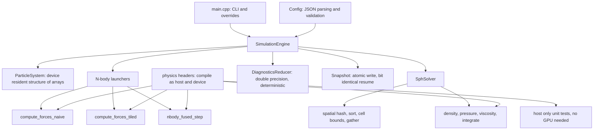

# Particle Physics Simulation

**A CUDA particle physics engine where every optimisation is a measured result and every physical law is enforced by a test.**

[](https://github.com/Olajide-Badejo/Particle-Physics-Simulation/actions/workflows/ci.yml)
[](LICENSE)
[](https://developer.nvidia.com/cuda-toolkit)
[](https://en.cppreference.com/w/cpp/23)
[-333.svg)](#reference-machine)

Two solvers sitting at opposite ends of the spectrum a GPU cares about:
**direct all pairs gravitational N-body dynamics**, which is regular and
arithmetic bound, and **weakly compressible smoothed particle hydrodynamics**
with spatial hash neighbour search, which is irregular and has to rediscover
its own data dependencies every step.

Author: **Olajide Badejo**

---

## Contents

- [What this project is](#what-this-project-is)
- [Headline results](#headline-results)
- [The kernel ladder](#the-kernel-ladder)
- [Two results that contradicted my expectations](#two-results-that-contradicted-my-expectations)
- [Physics correctness](#physics-correctness)
- [The fluid solver](#the-fluid-solver)
- [Architecture](#architecture)
- [Reports and documents](#reports-and-documents)
- [Build and run](#build-and-run)
- [Reference machine](#reference-machine)
- [Repository layout](#repository-layout)

---

## What this project is

Most GPU projects claim a speedup. This one is built to make the claim
falsifiable, and it is organised around two commitments.

**No number without a run.** Every performance figure in this repository was
produced by a program here, written to a CSV alongside the commit, GPU, driver
and seed that produced it, and read back into the documents mechanically. There
are no hand copied numbers anywhere, and continuous integration fails if a
generated table stops matching its source data.

**Correctness is enforced, not observed.** A particle simulation that is subtly
wrong still looks convincing: fluid still sloshes, stars still orbit. So
correctness is pinned by ten conservation and distribution tests with hard
numerical thresholds, run on every build, against a library compiled with fast
math disabled so that no compiler flag can quietly relax them.

Both commitments earned their keep by telling me I was wrong twice, which is
what the [two corrections](#two-results-that-contradicted-my-expectations)
below are about.

---

## Headline results

| | |
|---|---|
| **Shared memory tiling** | **1.93x faster** than the naive kernel at 200,000 particles |
| **Sustained throughput** | **17.47 TFLOP/s** single precision |
| **Fluid solver** | **50,000 particles at 0.338 ms/step**, about 50x inside an interactive budget |
| **Physics gates** | **10 of 10 pass**, most with orders of magnitude of margin |
| **Energy conservation** | drift of **1.33e-05** over 10,000 steps, against a 1e-03 limit |
| **Snapshot and resume** | **bit identical**, proven for all four solver paths |
| **Full reproduction** | `make clean && make all` in **128 seconds** |

---

## The kernel ladder

Three N-body force kernels differ by exactly **one technique each**, so the
difference between two rungs is attributable to that technique and nothing
else. A parity test asserts all three agree with an independent double
precision CPU reference, so a performance difference can never be a difference
in what is being computed.

| particles | naive (ms) | tiled (ms) | fused (ms) | tiled speedup | fused vs tiled | tiled TFLOP/s |
|---:|---:|---:|---:|---:|---:|---:|
| 10,000 | 0.482 | 0.225 | 0.221 | 2.14x | +2.1% | 8.88 |
| 20,000 | 1.098 | 0.624 | 0.626 | 1.76x | -0.3% | 12.83 |
| 50,000 | 6.860 | 3.586 | 3.592 | 1.91x | -0.2% | 13.94 |
| 100,000 | 23.773 | 12.296 | 12.498 | 1.93x | -1.6% | 16.27 |
| 150,000 | 51.221 | 26.380 | 26.378 | 1.94x | +0.0% | 17.06 |
| 200,000 | 88.265 | 45.781 | 45.724 | 1.93x | +0.1% | 17.47 |


---

## Two results that contradicted my expectations

This is the part of the project I would keep if I could keep only one.

### 1. Kernel fusion was expected to be worth 10 to 20 percent. It is worth 0.1 percent.

Fusing the force evaluation with the integrator removes a round trip of the
acceleration array, 24N bytes per step, plus a kernel launch. Stated in bytes
that sounds substantial.

The arithmetic settles it before any profiler is involved: 24N bytes at 200,000
particles is **0.0088 ms** at the measured streaming bandwidth of 545.8 GB/s,
against a step of **45.78 ms**. That is **0.019 percent** as an *absolute
ceiling* on what fusion could ever deliver. No implementation, however good,
could have reached ten percent.

The reason is arithmetic intensity: an all pairs sum is O(N²) arithmetic over
O(N) data, so it is not waiting on memory at all. Hardware counters confirm it,
putting device memory throughput **below one percent of peak** for every
variant. An optimisation that removes memory traffic cannot help a problem that
was never waiting on memory.

### 2. Tiling is not a bandwidth optimisation here, even though it works

Shared memory tiling is conventionally introduced as a way to reduce device
memory traffic. On this problem that explanation is simply wrong, and the
counters say so.

| variant | L1 and load store | L2 | device memory | global load sectors | warp issue |
|---|---:|---:|---:|---:|---:|
| naive | **79.58%** | 1.74% | 0.50% | 1,250.0M | **49.74%** |
| tiled | **39.72%** | 1.81% | 0.84% | 19.6M | **74.15%** |
| fused | 39.79% | 2.08% | 0.75% | 19.6M | 74.27% |

Tiling cuts global load sectors by **63.8x**, taking first level cache
throughput from a near saturated 79.6 percent down to 39.7 percent. Warp issue
efficiency rises from 49.7 to 74.2 percent: the naive kernel spends about half
its time with **nothing to issue**, because its warps are stalled on the load
store pipe, not on memory bandwidth. Arithmetic instruction counts are
identical across all three variants, which is what licenses attributing the
whole difference to data movement.

Practically: had I trusted the textbook description and attacked device memory
traffic, nothing would have happened.


---

## Physics correctness

Ten gates, all passing, all measured against a library compiled with fast math
**disabled**. Values are read from `experiments/results/validation_gates.csv`,
which the test suite writes on every run.

| gate | measured | limit | verdict |
|---|---:|---:|:--:|
| Two body energy drift over 10,000 steps | 1.33e-05 | < 1e-03 | pass |
| Two body orbit departure from circular | 9.35e-06 | < 1e-03 | pass |
| Plummer momentum drift over 1,000 steps | 1.23e-08 | < 1.19e-02 | pass |
| Force against double precision CPU reference | 5.77e-07 | < 1e-05 | pass |
| Pairwise force antisymmetry residual | 1.53e-07 | < 1e-06 | pass |
| Plummer radial density chi squared p value | 0.4416 | > 0.05 | pass |
| SPH poly6 kernel normalisation error | 6.48e-08 | < 1e-03 | pass |
| SPH spiky kernel normalisation error | 4.39e-08 | < 1e-03 | pass |
| SPH interior density relative error | 0.0420 | < 0.05 | pass |
| SPH neighbour search against brute force | 3.20e-07 | < 1e-04 | pass |


The *shape* matters as much as the magnitude. The error rises and then settles
onto a bounded plateau instead of growing without limit, which is the property
a symplectic integrator guarantees and a non symplectic one does not. The test
also compares the worst error in the second half of the run against the first,
so a scheme that had begun to accumulate would fail even with a small total.


The sampled sphere fits the analytic Plummer profile at **p = 0.44**. The same
test run against a model whose scale radius is deliberately ten percent wrong
returns p below 1e-06, which is what establishes the test can reject at all.

Full derivations, and what each gate is designed to catch, are in
[docs/physics_validation.md](docs/physics_validation.md).

---

## The fluid solver

Weakly compressible SPH with a three prime spatial hash, CUB radix sort, and a
fused force and integration pass.

| particles | ms per step | steps per second |
|---:|---:|---:|
| 10,000 | 0.2519 | 3,969 |
| 25,000 | 0.2673 | 3,740 |
| 50,000 | 0.3375 | 2,963 |
| 75,000 | 0.5396 | 1,853 |
| 100,000 | 0.5906 | 1,693 |


One design point is worth calling out, because it is the subtlest correctness
issue in the project. Hashing is many to one, so two of the twenty seven cells
the neighbour search visits can land in the same bucket, and a naive scan would
then **count those neighbours twice**. Filtering by distance does not save you:
those particles genuinely are within the smoothing radius. The engine stores an
exact 64 bit cell key per particle and compares it during the scan, and a gate
verifies the resulting density field against a brute force O(N²) sum to three
parts in ten million.

---

## Architecture



The force law, smoothing kernels and spatial hash live in headers that compile
both as device code and as ordinary host C++. The kernels and the tests
therefore cannot drift apart, and the formula level tests run in continuous
integration on a machine with no GPU. The one place this sharing is
deliberately avoided is the double precision force reference, where sharing
code would make the test and the implementation agree by construction and prove
nothing.

More in [docs/architecture.md](docs/architecture.md).

---

## Reports and documents

Two documents ship with the project and rank equally. Both are compiled from
the recorded results by the same pipeline, so no number in either is typed by
hand.

| document | what it covers |
|---|---|
| **[Main report (PDF, 28 pages)](report/main.pdf)** | Background, method, implementation, results and discussion. |
| **[Debug report (PDF, 14 pages)](report_debug/debug_report.pdf)** | Every defect found during the build, how it was diagnosed, why each fix was chosen over the alternatives, and what the failures had in common. |

The debug report exists because in a project whose output is numbers, the
history of the numbers that were wrong is worth as much as the ones that were
right. Five of its eleven entries are defects that produced **plausible output
while being wrong**, and those took almost all of the time: a build silently
targeting the wrong GPU architecture, a benchmark reading a corrupted column,
an optimisation quietly doing nothing.

**Supporting documentation**

- [docs/architecture.md](docs/architecture.md), engine and kernel structure
- [docs/physics_validation.md](docs/physics_validation.md), every gate with its theory and measured result
- [docs/DESIGN_DECISIONS.md](docs/DESIGN_DECISIONS.md), what was chosen, what was rejected, and what measurement later contradicted
- [docs/ENGINEERING_LOG.md](docs/ENGINEERING_LOG.md), the dated log the debug report is built from
- [PROGRESS.md](PROGRESS.md), phase by phase record with the checks run at each gate
- [CONTRIBUTING.md](CONTRIBUTING.md), test levels and house rules

**Raw results**, all regenerated by `make all`:

- [experiments/results/benchmarks.csv](experiments/results/benchmarks.csv), every timing with full provenance
- [experiments/results/validation_gates.csv](experiments/results/validation_gates.csv), every gate value
- [experiments/results/profile_summary.csv](experiments/results/profile_summary.csv), the hardware counters
- [report/figures/](report/figures/), every chart as both PDF and PNG

---

## Build and run

A CUDA capable GPU is needed for the execution tests, the benchmarks and the
profiler. It is **not** needed to build the project or run the host test suite.

```bash
git clone https://github.com/Olajide-Badejo/Particle-Physics-Simulation.git
cd Particle-Physics-Simulation
make setup
make all
```

`make all` builds everything, runs the style gate and the full test suite,
probes the device, runs the benchmark sweep and the profiler, regenerates every
figure and table, and compiles both reports.

**Measured wall clock for `make clean && make all` on the reference machine:
128 seconds**, including re-fetching both dependencies and compiling the device
library twice. The four test suites within that are 0.07 s host unit, 0.41 s
device unit, 1.17 s integration and 4.98 s validation.

No GPU or CUDA toolkit at hand:

```bash
make setup-host-only   # configures without CUDA entirely
make test              # 59 unit tests covering formulas, parsing and snapshots
```

Individual targets:

```bash
make build        # compile
make test         # the whole suite through ctest
make validate     # the physics gates
make bench        # the benchmark sweep, resuming where it left off
make profile      # hardware counters through Nsight Compute
make reports      # both PDFs
make check-style  # the style gate
```

Run a simulation directly:

```bash
./build/bin/cuda_physics_sim --config configs/dam_break_50k.json
./build/bin/cuda_physics_sim --config configs/plummer_10k.json --variant fused
./build/bin/cuda_physics_sim --config configs/plummer_10k.json --resume
./build/bin/cuda_physics_sim --device-info
```

---

## Reference machine

| Component | Value |
|---|---|
| GPU | NVIDIA GeForce RTX 5070, compute capability 12.0, 48 SMs |
| Memory | 192 bit bus, 672.0 GB/s theoretical peak |
| Measured bandwidth | 545.8 GB/s streaming copy, 81.2 percent of peak |
| CPU | Intel Core i7-14700K |
| OS | Windows 11 Pro, built and run inside WSL2 Ubuntu 26.04 |
| Toolchain | CUDA 13.3.73, GCC 15.2.0, C++23, CMake 4.4.0 |

Utilisation figures are quoted against the **measured** 545.8 GB/s, never the
theoretical peak. Quoting against a peak no kernel can reach flatters every
kernel by the same factor while saying nothing about any of them.

---

## Reproducibility

Every configuration carries an explicit seed, and initial conditions are
generated from a written out uniform mapping rather than a standard library
distribution, whose sequence is not specified across implementations. Every
benchmark row records the seed, commit, CUDA runtime and driver versions, fast
math setting and a timestamp.

Snapshots are written to a temporary file and renamed into place, so an
interrupted run never leaves a half written snapshot for a later resume to pick
up. A test asserts that stopping and resuming reproduces a straight through run
**bit for bit**, for all three N-body variants, for the fluid solver, and for a
run resumed twice.

---

## Repository layout

```text
include/physics/   force law, SPH kernels, spatial hash (host and device)
include/core/      configuration, particle state, engine, snapshots, diagnostics
src/kernels/       every CUDA kernel
src/core/          engine, parsing, snapshots, initial conditions
tests/             unit (host and device), integration, validation
benchmarks/        the sweep driver
scripts/           style gate, plotting, report assets, profiling
configs/           the three shipped configurations
experiments/       recorded results
report/            main report sources and figures
report_debug/      debug report sources
```

---

## License

[MIT](LICENSE). Copyright 2026 Olajide Badejo.
