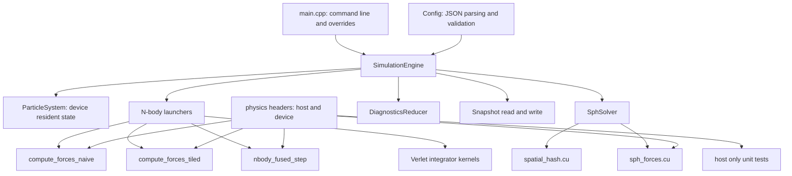
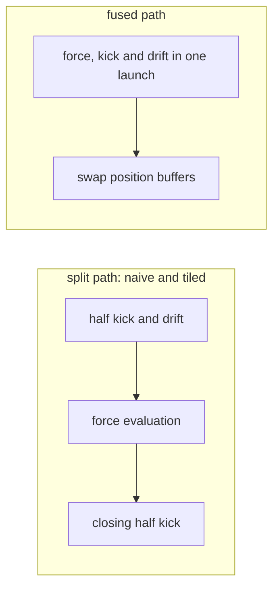
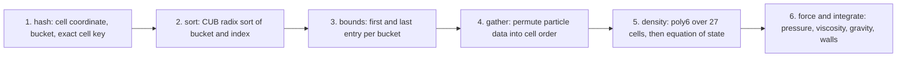

# Architecture

How the engine is put together, and why each boundary is where it is.

## Layers

The one boundary worth explaining is the `physics` headers. The force law, the
smoothing kernels, the equation of state and the spatial hash are written once,
marked to compile both as device code and as ordinary host C++, and included by
both the kernels and the tests. The kernels and the tests therefore cannot
drift apart, and the formula level tests run on a machine with no GPU.

The exception is deliberate: the double precision reference used by the force
gate shares no code with the kernels at all. Sharing there would mean the test
and the implementation agreeing because they are the same code, which proves
nothing.

## Library split

There are three library targets and the split is not incidental.

| target | contents | why |
|---|---|---|
| `physics_host` | configuration, snapshots, initial conditions, progress | no CUDA runtime dependency, so continuous integration can build and run a meaningful slice of the tests without a GPU |
| `physics_core` | all device code, respects the fast math switch | what the benchmarks and the demo link |
| `physics_core_strict` | the same sources, fast math forced off | what every validation test links |

Building the device library twice from identical sources is what makes the
physics gates trustworthy. The benchmark builds want `--use_fast_math`, which
lowers the reciprocal square root to a hardware approximation. The energy drift
gate resolves one part in a thousand and that approximation does not leave
enough headroom. A gate that a compiler flag can relax is not a gate.

## The N-body step

The split path runs true velocity Verlet across three launches. The fused path
runs the leapfrog form in one launch, which produces the same position sequence
to rounding provided the velocity is offset backwards by half a step once
before the loop begins.

Positions are double buffered on the fused path. There is no grid wide barrier
inside a launch, so a block that has finished its force sum would otherwise
overwrite a position another block is still reading. The second buffer costs
12N bytes of memory and no bandwidth, because the write happens either way.

## The fluid step

Two points matter.

The permutation is kept. After a step the particle arrays are in cell sorted
order, which is the order the next step wants, so the sort has an effect that
outlives the step that paid for it. Because that permutation must be a
bijection, one test checks the multiset of masses is unchanged across a step
and another checks total mass over two thousand steps.

The bucket scan compares an exact 64 bit cell key before accepting a candidate.
This is a correctness requirement, not an optimisation. Hashing is many to one,
so two of the twenty seven visited cells can land in the same bucket, and a
scan without the comparison would count those particles twice. Distance
filtering does not help, because those particles genuinely are within the
smoothing radius.

## Data layout

Structure of arrays: thirteen float arrays rather than one array of structures.

With an array of structures a warp reading the `x` component of thirty two
consecutive particles touches thirty two separate cache lines and uses a
fraction of each. With separate arrays the same read is thirty two consecutive
floats. This is also why the naive kernel is a fair baseline rather than a straw
man: it already starts from a coalesced layout, so the ladder measures tiling
rather than measuring a layout mistake.

| array group | count | purpose |
|---|---|---|
| x, y, z | 3 | positions |
| x_next, y_next, z_next | 3 | staged positions for the fused kernel |
| vx, vy, vz | 3 | velocities, synchronised or half step by convention |
| ax, ay, az | 3 | accelerations |
| mass | 1 | particle mass |

## Determinism

Three mechanisms, all load bearing for the bit identity guarantee.

Diagnostic reductions accumulate in double and sum block partials on the host in
a fixed order rather than with atomics, so two runs agree bit for bit.

The half step velocity correction the fused variant needs is applied inside the
reduction kernel rather than by shifting the velocity array and shifting it
back, because in single precision that round trip does not return the original
bits and would make a diagnostic perturb the run it measures.

Accelerations are not stored in snapshots. They are a deterministic function of
the positions, so recomputing them on load reproduces exactly the array the
original run held.
