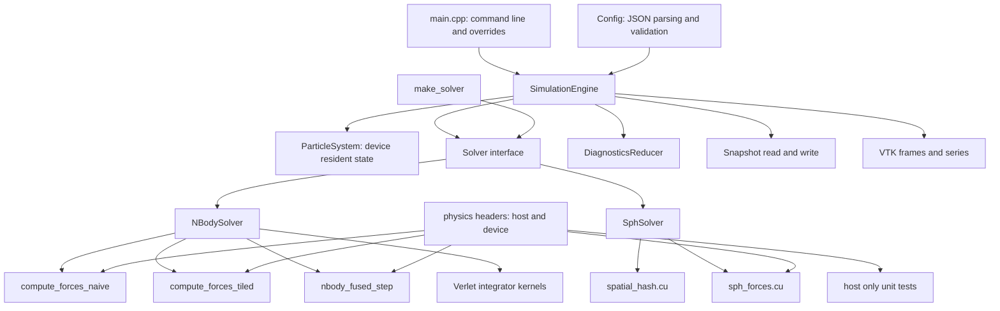
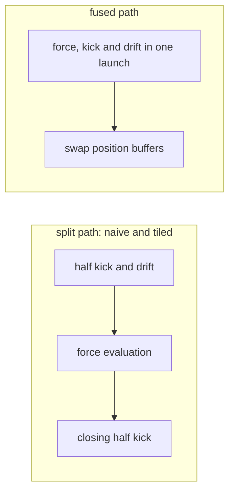
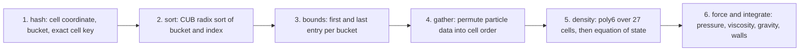

# Architecture

How the engine is put together, and why each boundary is where it is.

## Layers

The one boundary worth explaining is the `physics` headers. The force law, the
smoothing kernels, the equation of state and the spatial hash are written once,
marked to compile both as device code and as ordinary host C++, and included by
both the kernels and the tests. The kernels and the tests therefore cannot
drift apart, and the formula level tests run on a machine with no GPU.

The exception is deliberate: the double precision reference used by the force
gate shares no code with the kernels at all. Sharing there would mean the test
and the implementation agreeing because they are the same code, which proves
nothing.

## Library split

There are three library targets and the split is not incidental.

| target | contents | why |
|---|---|---|
| `physics_host` | configuration, snapshots, VTK output, initial conditions, progress | no CUDA runtime dependency, so continuous integration can build and run a meaningful slice of the tests without a GPU |
| `physics_core` | all device code, respects the fast math switch | what the benchmarks and the demo link |
| `physics_core_strict` | the same sources, fast math forced off | what every validation test links |

Building the device library twice from identical sources is what makes the
physics gates trustworthy. The benchmark builds want `--use_fast_math`, which
lowers the reciprocal square root to a hardware approximation. A gate that a
compiler flag can relax is not a gate. FMA contraction is not disabled in the
strict library.

The default build targets `sm_120`. `-DCPS_FAT_BINARY=ON` builds `physics_core`
for `75;80;86;89;90;120`, which continuous integration and releases use;
`physics_core_strict` and the tests stay on the default.

## The solver interface

`SimulationEngine` knows nothing about the physics it runs. It keeps the loop, the
file output, the timing, the diagnostics reductions and the velocity convention, and
holds a `std::unique_ptr<Solver>` for everything else. `make_solver(config)` is the one
place that turns a solver type into an object. Adding a solver means adding a class and
a case there.

| `Solver` member | When the engine calls it | `NBodySolver` | `SphSolver` |
|---|---|---|---|
| `initialize` | fresh run, after the upload, before the convention shift | seeds `a_0` with the tiled kernel, in every variant | nothing |
| `on_resume` | resume, after the upload, before the convention shift | recomputes the acceleration with the tiled kernel, in every variant | nothing, so the first diagnostic row after a resume reads a zero acceleration |
| `step` | every step | split Verlet, or fused and a buffer swap | the six passes |
| `velocity_convention` | at each convention shift | half step for fused, synchronised otherwise | half step |
| `prepare_diagnostics` | before a reduction | fused recomputes the force at the current positions; otherwise nothing | nothing |
| `has_potential_energy` | at a diagnostic | yes | no |
| `check_device_errors` | before a diagnostic or a snapshot, and at the end of a run | nothing | reads the non-finite position flag, which drains the stream |
| `startup_description` | once, for the configuration block | nothing | the derived resolution and the time step limits |
| `graph_capturable` | after `initialize` or `resume` settle | yes for naive and tiled, no for fused | yes |

The first six have no default, because a solver that silently inherited an empty
`on_resume` would only show up as a resumed run drifting from a straight one.

The solver states its convention, and the engine does the rest: it records what the
velocity array holds, shifts it when the two disagree, reads it in the reductions and
writes the snapshot flag. The shift reads the acceleration array, which is why
`initialize` and `on_resume` run before it. A resume across conventions then works for
any pair of solvers, including one a later release adds.

A second constructor takes a `Solver` directly. `tests/integration/test_solver_interface.cpp`
uses it to run a test-only solver through a whole run, a snapshot and a resume, and to
check which hook ran when. The configuration still decides what a snapshot records as
the physics, through `physics_fields`, so a new solver type also needs its fields there.

## The N-body step

The split path runs true velocity Verlet across three launches. The fused path
runs the leapfrog form in one launch, which produces the same position sequence
to rounding provided the velocity is offset backwards by half a step once
before the loop begins.

Both integrator launches on the split path read the acceleration array, 24N bytes
per step. The fused launch reads it in neither. It still writes it, 12N bytes,
though nothing reads that write, because the diagnostics and the velocity
conversions recompute the force first.

Positions are double buffered on the fused path. There is no grid wide barrier
inside a launch, so a block that has finished its force sum would otherwise
overwrite a position another block is still reading. The second buffer costs
12N bytes of memory and no bandwidth, because the write happens either way.

`nbody.tile_size` picks the tile width of the tiled force evaluation, and of the
fused launch, from 32, 64, 128 and 256, each its own instantiation so the inner loop
can be unrolled. It changes how the sum is staged and not what it adds up: j runs in the
same order at every width, and a padded slot adds `+0.0`. One step at each width is bit
identical in the strict library, which `TileWidthTest` holds, and it is byte identical
in the fast math library on the runs that were compared, which nothing asserts. So the
width is run control, like `block_size`, and stays out of the physics fingerprint.

## The fluid step

Three points matter.

The update in step 6 is the same kick drift leapfrog as the fused N-body kernel,
with no initial offset applied, and its viscous term is first order.

The permutation is kept. After a step the particle arrays are in cell sorted
order, which is the order the next step wants, so the sort has an effect that
outlives the step that paid for it. Because that permutation must be a
bijection, one test checks the multiset of masses is unchanged across a step
and another checks total mass over two thousand steps. `id` travels through the
gather and the write-back the same way, and a third test follows each id across
every step, as described under particle ids below.

The bucket scan compares an exact 64 bit cell key before accepting a candidate.
This is a correctness requirement, not an optimisation. Hashing is many to one,
so two of the twenty seven visited cells can land in the same bucket, and a
scan without the comparison would count those particles twice. Distance
filtering does not help, because those particles genuinely are within the
smoothing radius.

## Streams and synchronisation

The engine owns one non-blocking stream, and every launch, copy, timer event and
CUB call on the solver path runs on it: the N-body variants, the integrators, the
velocity offset, the six fluid passes and the diagnostics. A launcher takes its
stream with no default, so leaving it out does not compile. A non-blocking stream
is ordered against nothing else, including the legacy default stream, so a read
that relies on the old implicit ordering is a bug here rather than a coincidence.
This is also the shape a captured graph needs.

`step()` does not synchronise. The host waits only where it needs an answer:

| Point | Waits by |
|---|---|
| `initialize()`, `resume()` | draining the stream before returning, so a caller can touch the arrays |
| A stretch of timed steps ends | the solver clock's closing event |
| A diagnostic | copying the block partials on the stream, then draining it |
| Non-finite flag, snapshot, end-of-run scan | the same, through pinned staging |
| `synchronize()` | draining the stream, for code that reads the arrays itself |
| The destructor | draining the stream before any buffer is freed |

Partial sums are still added up on the host in block order, after the stream
ordered copy, so the reduction stays deterministic. Device memory is zeroed through
the default stream at construction, and `DeviceBuffer::zero` waits for that, because
nothing on the engine's stream would be ordered against it.

`-DCPS_DEBUG_SYNC=ON` drains the stream after every launch and copy. If a failure
goes away in that build, something was reading ahead of the stream. Results must
match the normal build; timings from it mean nothing. A captured step counts as one
launch, so a graph run drains once per step; run with `--graphs off` to drain between
the passes of a step as well.

## Captured graphs

With `run.use_graphs` on, which is the default, the naive, tiled and fluid steps are
captured once into a CUDA graph and launched as a unit. `--graphs off` runs them on the
stream. The same kernels run in the same order with the same arguments, so a graph run
and a stream run are bit identical, and that is a test
(`tests/integration/test_graphs.cpp`). Only the launch changes, so a graph can remove
only the time between kernels. A solver opts in with `graph_capturable`; one that does
not runs on the stream whatever the setting says.

**Why fused is not captured.** It launches a single kernel, so there is no time between
kernels to remove, and measuring it showed no gain at any size. Capturing it would also
need a graph for each way round its position buffers can be, because a captured node
keeps the pointers it was given and the kernel swaps them every step. With graphs on, a
fused run goes on the stream, and `cps run` says so where it reports capture.

**Why it is on.** The rule, written before measuring, was on only if graphs beat the
stream path by more than the spread somewhere and lost beyond the spread nowhere. In
interleaved runs they gained at every fluid size and at small N for the split N-body
variants, which launch several kernels a step. They changed nothing measurable for
large N, where those gaps are too small a share of the step.

**When.** At the end of `initialize()` and `resume()`, with the stream drained and the
pointers and velocity convention settled. Capturing runs nothing on the device. Its
cost is host time before the first step, so neither the solver nor the wall figure has
it; `cps run` prints it, and `SimulationEngine::graph_capture_milliseconds()` returns it.

**What a capture bakes in.** Every pointer and scalar `step` passes: `dt`, the particle
count, the fluid's derived parameters and all the device arrays. None of them changes
during the life of an engine, because a change of `dt` means a new configuration and so
a new engine and a new capture. CUB's radix sort captures along with everything else,
its temporary storage being allocated up front, so the fluid step is one graph with no
part left on the stream.

**What stays outside.** Diagnostics, snapshots, frames, the device error flag and the
non-finite scans all run on the stream between launches, against the state they always
saw. The hash pass inside the graph sets the same device flag, which is read outside.

**Tools.** An NVTX range is host code, so the ranges around the fluid's passes fire once
during capture, inside a `graph capture` range, and never at a launch. The `step` range
still fires per step. `scripts/profile_kernels.sh` and `scripts/profile_sph_split.sh`
run with `--graphs off`, because they report per kernel and per launch. Their figures
describe the stream path.

## Data layout

Structure of arrays: thirteen float arrays and one id array rather than one array
of structures.

With an array of structures a warp reading the `x` component of thirty two
consecutive particles touches thirty two separate cache lines and uses a
fraction of each. With separate arrays the same read is thirty two consecutive
floats. This is also why the naive kernel is a fair baseline rather than a straw
man: it already starts from a coalesced layout, so the ladder measures tiling
rather than measuring a layout mistake.

| array group | count | purpose |
|---|---|---|
| x, y, z | 3 | positions |
| x_next, y_next, z_next | 3 | staged positions for the fused kernel |
| vx, vy, vz | 3 | velocities, synchronised or half step by convention |
| ax, ay, az | 3 | accelerations |
| mass | 1 | particle mass |
| id | 1 | `uint32` label of the particle; see below |

## Particle ids

Each particle has an id, 0 to N-1 in the initial state's order. Ids label particles
and do nothing else: no force, sort key or integrator reads them, and the trajectories
are bit for bit what they were before ids existed.

N-body never permutes, so there an id is just the slot number. The fused position swap
exchanges position buffers and leaves `id` alone. The fluid solver permutes every step,
so `id` joins `mass` in the gather and the write-back. `ParticleIds.EachIdMovesContinuouslyThroughTheSort`
is what shows the permutation is right: looked up by id, every particle must have moved by
no more than its speed allows since the previous step, which a label on the wrong particle
misses by a whole particle spacing.

## Determinism

Three mechanisms, all load bearing for the bit identity guarantee.

Diagnostic reductions accumulate in double and sum block partials on the host in
a fixed order rather than with atomics, so two runs agree bit for bit.

The half step velocity correction the fused variant needs is applied inside the
reduction kernel rather than by shifting the velocity array and shifting it
back, because in single precision that round trip does not return the original
bits and would make a diagnostic perturb the run it measures.

Accelerations are not stored in snapshots. They are a deterministic function of
the positions, so on the N-body path recomputing them on load reproduces exactly
the array the original run held. The fluid solver keeps no force pass outside its
step, so the first diagnostic row after a fluid resume reads a zero acceleration;
the trajectory is unaffected.

## Snapshots

The format is `CPS2`, laid out in `include/cps/core/snapshot.hpp`: a 64 byte header, a
table with one 40 byte entry per array, and the payload. It records a 64 bit step, the
simulated time, a physics fingerprint and a payload checksum. `CPS1` from `v1.0.0` is still
read, with a warning, and never written.

`id` is one more entry in the table, not a format change, and older builds skip it. A file
with no `id` loads with ids in file order, and for a fluid snapshot written before ids existed
those labels are arbitrary but consistent from then on. An `id` that is there is checked:
right type and length, every value below the count, no duplicates.

## Output path

Diagnostics, snapshots and VTK frames take the same route out of the engine. Each runs between
steps, after the solver clock has stopped and inside the wall clock, and each ends by draining the
stream, which the download needs anyway. A frame or a snapshot goes through
`ParticleSystem::download` and the pinned staging buffer, then the non-finite check, so a blown-up
state reaches neither.

The frame writer in `include/cps/io/vtk.hpp` is a pure function from host arrays to a `.vtp` file,
in `physics_host`, so its tests need no GPU. `VtkSeries` adds the `.pvd` index and owns the two
guarantees that matter when a run dies:

- A frame goes to a temporary file and is renamed into place, and only then is the index rewritten
  the same way. The index therefore only ever names complete frames.
- On resume, the index goes first and the frames past the snapshot's step come after, including one
  that was renamed into place just before a kill and that the index never named.

Together with frames falling only on multiples of the cadence, that makes a killed and resumed run
produce the same frames, to the byte, as one that never stopped. The velocity in a frame is what the
state holds, half step for the fused and fluid solvers, and `VelocityConvention` in the field data
records which. Unlike diagnostics, which shift it to report an energy, a frame does not correct it.
